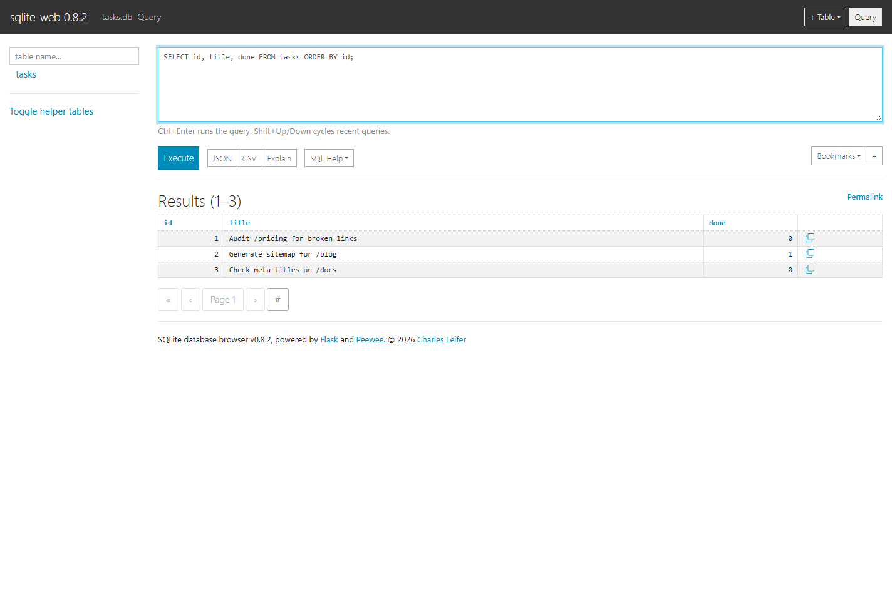

# SEO Audit Task Queue — SQLite-backed Task API

**FlyRank Backend AI Engineering · W3/A1 (BE-02)** — the Week 2 CRUD API with one thing changed: the in-memory list is gone. Tasks now live in a SQLite database, so they survive server restarts.

This is the whole point of the assignment: **the API contract did not change at all.** Same URLs, same request bodies, same response bodies and status codes. Only the storage layer was replaced.

```
Week 2:  Client → API → Python list in memory   (data dies with the process)
Week 3:  Client → API → SQLite file tasks.db    (data survives restarts)
```

## Why SQLite

- **Zero setup** — it is a single file and ships with Python's standard library (`sqlite3`), so no server to install, configure or run.
- **Perfect fit for a local internship project** — the database is created automatically on first start and can be inspected or edited directly.
- **Real SQL, real persistence** — `SELECT`, `INSERT`, `UPDATE`, `DELETE` and transactions behave the same way as in PostgreSQL/MySQL. When this project moves to a bigger database later, only `database.py` needs to change.

## How to run

```bash
python -m pip install -r requirements.txt
python -m uvicorn main:app --reload
```

One documented start command: **`python -m uvicorn main:app --reload`** → open http://localhost:8000/docs.

Run the checks with `python -m pytest -q` (9 tests).

### Where the database lives

`tasks.db` in the project root. It is created automatically if missing, is deliberately gitignored, and can be moved by setting `TASKS_DB_PATH`. On first run the app creates:

```sql
CREATE TABLE IF NOT EXISTS tasks (
    id INTEGER PRIMARY KEY,
    title TEXT NOT NULL,
    done INTEGER NOT NULL CHECK (done IN (0, 1)),
    created_at TEXT NOT NULL DEFAULT CURRENT_TIMESTAMP,
    updated_at TEXT NOT NULL DEFAULT CURRENT_TIMESTAMP
);
```

Three example jobs are inserted **only when the table is empty** — restarting five times still gives three rows, not fifteen. The three inserts run inside the connection's transaction and commit together when the `with connection` block exits, so a crash mid-seed cannot leave a half-seeded table.

`created_at` / `updated_at` are stored for every task but deliberately not exposed, so the JSON responses stay byte-for-byte identical to Week 2. Adding those columns meant changing the table's shape — that uneasy "what if existing rows break?" feeling is exactly why real teams write **migrations** instead of editing tables by hand. `CREATE TABLE IF NOT EXISTS` plus `CREATE INDEX IF NOT EXISTS` here are the simplest possible migration.

Two indexes are created on first run: `idx_tasks_done` for `WHERE done = ?` and `idx_tasks_title` for title lookups/ordering. An index is a sorted side-structure that lets SQLite find matching rows without scanning the whole table. Be honest about its limits: a leading-wildcard `LIKE '%term%'` still scans, while equality on `done` benefits directly.

## Endpoints (unchanged from Week 2)

| Method | Path | What it does | Success | Errors |
| --- | --- | --- | --- | --- |
| `GET` | `/` | API name, version, main endpoint | `200` | — |
| `GET` | `/health` | Liveness probe | `200` | — |
| `GET` | `/tasks` | List; SQL `WHERE done = ?`, `LIKE ?search?`, `LIMIT/OFFSET` | `200` | `400` |
| `GET` | `/tasks/{id}` | Fetch one row | `200` | `404` |
| `POST` | `/tasks` | `INSERT`, assign next id, `done = 0` | `201` | `400` |
| `PUT` | `/tasks/{id}` | Partial SQL `UPDATE` of `title` and/or `done` | `200` | `400`, `404` |
| `DELETE` | `/tasks/{id}` | SQL `DELETE`, empty body | `204` | `404` |
| `GET` | `/stats` | Server counts via SQL `COUNT()` | `200` | — |
| `POST` | `/reset` | Restore the three seeded rows | `200` | — |

Every error keeps the Week 2 shape, `{"error": "..."}`; unknown ids return `{"error": "Task 99 not found"}` so clients cannot tell the storage changed.

### A real response, via curl

```console
$ curl -i -X POST http://localhost:8000/tasks \
    -H "Content-Type: application/json" \
    -d '{"title":"Crawl /blog for orphan pages"}'

HTTP/1.1 201 Created
date: Fri, 27 Nov 2026 05:07:07 GMT
server: uvicorn
content-length: 60
content-type: application/json

{"id":4,"title":"Crawl /blog for orphan pages","done":false}
```

### Persistence check

Create two tasks, stop the server with `Ctrl+C`, start it again, and `GET /tasks`: both tasks are still there with the same ids. The same assertion is automated in `tests/test_api.py::test_data_survives_restart`.

## Separation of API and data layers

`main.py` contains **no SQL** — it validates input and calls functions in `database.py`. `database.py` owns connections, the schema, seeding and every query, and converts SQLite rows back into the exact JSON shape the API promised. Swapping SQLite for PostgreSQL later means rewriting one module, not the routes.

The Week 2 endpoint tests still pass **unchanged** against this version (plus three new persistence/SQL tests). Identical requests producing identical statuses and bodies while the assertions stay untouched is the proof that storage is just an implementation detail behind the API.


## Exploring the database

Viewer: `pip install sqlite-web` then `sqlite_web tasks.db --port 8003` (or use DB Browser for SQLite). Full write-up of all five queries: [docs/sql-queries.md](docs/sql-queries.md).



One query I ran in the viewer:

```sql
SELECT * FROM tasks WHERE done = 1;
-- (2, 'Generate sitemap for /blog', 1, ...)
```

`UPDATE tasks SET done = 1;` followed by `GET /stats` returned `{"total":3,"done":3,"open":0}` — the API read the external change immediately. That only worked after `connection.commit()`: uncommitted writes are invisible to other connections.

## Commit trail

`Stage 0: create SQLite database` → `Stage 1: database read endpoints` → `Stage 2: insert into database` → `Stage 3: update and delete with SQL` → `Stage 4: explored SQLite` → `Stage 5: database documentation`, plus `Extras: SQL indexes and migration notes` for the stretch goals. The repository also contains the full Week 2 history, so you can see the before/after of the storage swap in git.
