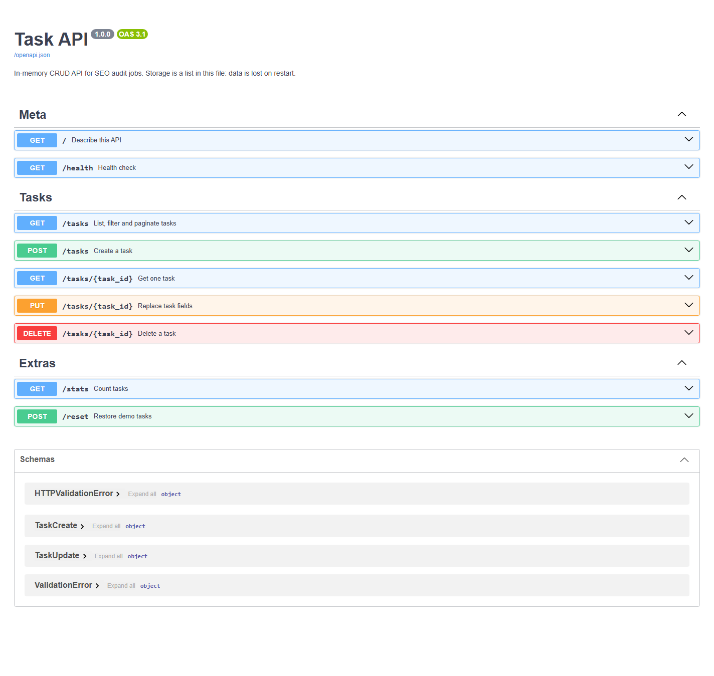

# SEO Audit Task Queue — Task API

A hand-built CRUD API for **FlyRank Backend AI Engineering · BE-01 (W2/A1)**.

Each "task" is an SEO audit job: `{"id": 1, "title": "Audit /pricing for broken links", "done": false}`. The endpoint contract is exactly the one the assignment specifies (`/tasks`), but the domain is the one FlyRank actually works in — a queue of report-generation jobs. Same code shape as a social network's posts or a shop's orders.

Built with **FastAPI** so validation, JSON serialization and interactive **Swagger UI** come from the framework, while the storage stays deliberately boring: a Python list in `main.py`. No database, no file writes.

## Run it

```bash
python -m pip install -r requirements.txt
python -m uvicorn main:app --reload
```

Open **http://localhost:8000/docs** for Swagger UI, or **http://localhost:8000/** for API metadata.

Run the checks with `python -m pytest -q` (6 tests).

## Endpoints

| Method | Path | What it does | Success | Errors |
| --- | --- | --- | --- | --- |
| `GET` | `/` | API name, version, main endpoint | `200` | — |
| `GET` | `/health` | Liveness probe for uptime monitors | `200` | — |
| `GET` | `/tasks` | List tasks; filter with `?done=true`, `?search=meta`, paginate with `?limit=2&offset=1` | `200` | `400` |
| `GET` | `/tasks/{id}` | Fetch one task | `200` | `404` |
| `POST` | `/tasks` | Create with `{"title": "..."}`; assigns next id and `done: false` | `201` | `400` |
| `PUT` | `/tasks/{id}` | Replace `title` and/or `done` (at least one required) | `200` | `400`, `404` |
| `DELETE` | `/tasks/{id}` | Remove a task, empty body | `204` | `404` |
| `GET` | `/stats` | Server-computed `total` / `done` / `open` counts | `200` | — |
| `POST` | `/reset` | Restore the three seeded demo jobs | `200` | — |

Every error is JSON: `{"error": "Task 99 not found"}` — never an empty `200` or FastAPI's default `422`. Invalid bodies are normalized to `400` by the `RequestValidationError` handler.

### A real response, via curl

```console
$ curl -i -X POST http://localhost:8000/tasks \
    -H "Content-Type: application/json" \
    -d '{"title":"Crawl /blog for orphan pages"}'

HTTP/1.1 201 Created
date: Fri, 27 Nov 2026 03:53:19 GMT
server: uvicorn
content-length: 60
content-type: application/json

{"id":5,"title":"Crawl /blog for orphan pages","done":false}
```

The full cycle — create (`201`), update (`200`), delete (`204`), unknown id (`404`), bad body (`400`) — is covered in `tests/test_api.py` and works through "Try it out" in Swagger UI too.

## Swagger UI



OpenAPI JSON (generated from the route signatures and docstrings) is served at `/openapi.json`.

## The mortality experiment

I created a task, stopped the server with `Ctrl+C`, restarted it, and called `GET /tasks`: my new task was gone and the list was back to the three seeded jobs. That happens because the "database" is a list inside the running Python process — when the process dies, its memory dies with it. This is exactly the problem a real database solves in Week 3.

## Why this is on my CV

- **CRUD contract, not a toy:** nine documented endpoints with honest status codes and a consistent JSON error shape.
- **Input is untrusted:** strict Pydantic types, empty-title rejection, a custom `422 → 400` handler, and optional-field checks on `PUT`.
- **Query design:** filtering, case-insensitive search and offset/limit pagination, plus a server-computed `/stats` endpoint. Real APIs don't return "everything".
- **Self-describing API:** generated OpenAPI, Swagger UI, and six pytest tests that run in under a second.
- **AI engineering, not just AI usage:** the "AI vs me" section below records a written specification, a competing implementation and a diff — the review loop matters more than the generated code.

## Commit trail

One commit per stage, in order: `Stage 0: hello server` → `Stage 1: root and health endpoints` → `Stage 2: read endpoints with 404` → `Stage 3: create with validation` → `Stage 4: full CRUD` → `Stage 5: Swagger UI` → `Extras: ...` → `Stage 6: publish and docs` → `Stage 7: AI vs me`.

## AI vs me

I wrote the prompt below from memory, without copying the assignment text, and asked an AI assistant to build that spec into `ai-version/`. My hand-built `main.py` stayed untouched. Both apps were started on separate ports and the same Stage 4 checkpoint curls were fired at each.

### The prompt I wrote

```text
Build me a small task API in Python with FastAPI for a FlyRank internship assignment. It should manage a to-do list with an in-memory Python list (no database, no files). Each task has an integer id, a title string, and a done boolean. Seed the list with three example tasks when the app starts.

I need these endpoints:
- GET / returns some JSON describing the API
- GET /health returns {"status": "ok"}
- GET /tasks returns all tasks
- GET /tasks/{id} returns one task or a 404 if it doesn't exist
- POST /tasks creates a task from {"title": "..."} and returns it
- PUT /tasks/{id} updates a task
- DELETE /tasks/{id} removes a task and returns no content

Use proper HTTP status codes: 200 for reads and updates, 201 for create, 204 for delete, 404 when an id is missing. Check that title is present and not blank before creating; reject bad input. Add Swagger docs at /docs with short descriptions. Put the code in ai-version/main.py and keep it runnable with uvicorn. Also add a requirements.txt there.
```

### How I compared them

```bash
python -m uvicorn main:app --port 8000
python -m uvicorn ai-version.main:app --port 8001
git diff --no-index main.py ai-version/main.py
```

The diff is `52 insertions(+), 125 deletions(-)`: the AI version is shorter because it uses typed Pydantic models and plain `HTTPException`s instead of my helper functions and dicts.

| Checkpoint curl | Mine (`:8000`) | AI version (`:8001`) |
| --- | --- | --- |
| `POST /tasks` with a title | `201`, id `4` | `201`, id `4` — pass |
| `GET /tasks/99` | `404 {"error": "Task 99 not found"}` | `404 {"detail": "Task 99 not found"}` — wrong key |
| `POST /tasks` with `{}` | `400 {"error": ...}` | `422 {"detail": [...]}` — wrong code and key |
| `PUT /tasks/4` with `{"done":true}` | `200`, task updated | `422` — partial update impossible |
| `DELETE /tasks/4` | `204`, empty body | `204`, empty body — pass |
| Delete, create, delete, create again | ids stay unique | two tasks both got id `5` |

### Four concrete differences

1. **Error contract.** The AI used FastAPI's native `HTTPException`, so every 4xx body is `{"detail": ...}`. My spec required `{"error": ...}` for every error. A client written against one would break against the other.
2. **Validation status.** It relied on Pydantic's default validation failure, which returns `422`. My version installs a `RequestValidationError` handler that returns `400` with a human-readable `error` message, as the assignment demands.
3. **PUT semantics.** The AI defined `TaskUpdate` with both `title` and `done` required, so "mark it done" (`{"done":true}`) is rejected. Mine treats fields as optional, requires at least one, and rejects `{}` with `400`.
4. **Id allocation.** The AI used `len(tasks) + 1`. After deleting task 4 and creating new jobs, it issued id `5` twice; `GET /tasks/5` then becomes ambiguous. Mine uses `max(existing ids) + 1`, so ids are never reused while a higher id still exists.

### What the AI did better

It modelled tasks as Pydantic `Task`/`TaskCreate`/`TaskUpdate` objects instead of raw dicts, which gives cleaner OpenAPI schemas and real type checking in an editor. I can explain its version line by line: `Task` instances are serialized by FastAPI into JSON, and `HTTPException` is caught by Starlette and rendered as `{"detail": ...}`. Its route handlers are also a few lines shorter than mine.

### What it got wrong or quietly ignored

All four differences above. It also invented generic seed data ("Write unit tests", "Review PR") because my prompt never mentioned SEO jobs — technically compliant, but it threw away the domain framing that makes this project worth showing.

### What my prompt forgot to specify

It said "reject bad input" but never said *which status code or body shape*, never said whether PUT was partial or a full replacement, never said how ids should be allocated after a delete, and never pinned the exact `GET /` payload or the optional extras. The AI silently decided all of those for me — which is the whole lesson: the output was only as good as the specification.

### Rematch

I rewrote the specification in `ai-version/improved-prompt.md` — exact error shape, `400` override, partial `PUT`, `max(id)+1`, exact root JSON and the extras — and regenerated the implementation into `ai-version/round2/main.py`. On the same failing curls, round 2 returns `400 {"error": ...}`, `404 {"error": ...}`, `200` for `{"done":true}` and unique ids. **One sentence on what changed:** naming the error contract and the update semantics explicitly removed every divergence I had found, without changing the language, framework or endpoint list.
