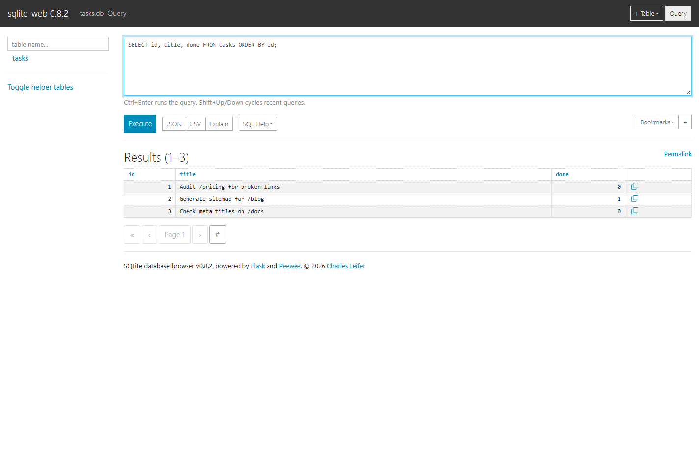

# SQL exploration (Stage 4)

Viewer: **sqlite-web** (`pip install sqlite-web`, then `sqlite_web tasks.db --port 8003`). The same queries also work in DB Browser for SQLite.



## The five queries I ran against `tasks.db`

```sql
SELECT * FROM tasks;
```

```
(1, 'Audit /pricing for broken links', 0, '2026-11-27 05:06:14', ...)
(2, 'Generate sitemap for /blog',       1, '2026-11-27 05:06:14', ...)
(3, 'Check meta titles on /docs',       0, '2026-11-27 05:06:14', ...)
```

```sql
SELECT * FROM tasks WHERE done = 1;
```

```
(2, 'Generate sitemap for /blog', 1, ...)
```

```sql
SELECT COUNT(*) FROM tasks;
```

```
3
```

```sql
UPDATE tasks SET done = 1;
```

After committing the write, `GET /stats` through the API returned `{"total":3,"done":3,"open":0}` — the API immediately saw the external change because it reads the same file on every request.

```sql
DELETE FROM tasks WHERE done = 1;
```

After committing, `GET /tasks` returned `[]`. `POST /reset` restored the three seeded jobs.

## What I noticed

My first attempt didn't show any change through the API. The reason was that my external `UPDATE` was still sitting in an uncommitted transaction — SQLite readers see only committed data. Calling `connection.commit()` fixed it instantly. This is a real database behaviour you cannot observe with an in-memory list: the file is shared, and transactions control when writes become visible.
